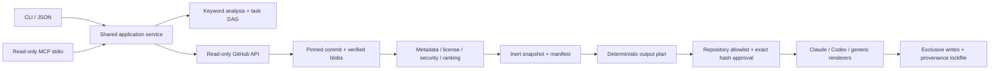

# MVP architecture

The workspace started empty, without Git metadata or synced source files. All implementation lives in this independent `stratagent/` directory; the parent `sources/` directory remains untouched.

## Boundaries

`planner.py` has no IO. It maps bilingual domain keywords into search terms and a five-task dependency graph. It clearly identifies its method as deterministic.

`github.py` uses fixed-host HTTPS GET requests with timeouts, budgets, no redirects and sanitized errors. Discovery resolves a branch once to a commit and tree. Every downloaded file must match its pinned Git blob identity. Git archives, clone hooks, repository scripts and remote package managers are never used.

`security.py` validates paths, text encoding, sizes, modes, metadata, license notices and static risk signals. It produces a canonical review digest bound to origin, immutable source identities, content hashes and findings. All candidates still require human review.

`service.py` owns initialization, discovery, review, role recommendations, local allowlist, install/configuration previews, approval, provenance and verification. Cache is inert JSON/base64. No candidate is installed by discovery. Only matching, explicitly installed candidates are bound into generated tasks.

`adapters.py` is a pure renderer. Skill references remain relative. Provider-specific frontmatter is stripped, Claude roles are constrained to read-only exploration, and Codex roles become Agent Skills. No host config is overwritten. Adapter output hashes are part of approval.

`workspace.py` enforces safe relative paths, refuses symlink components, serializes writes using a local directory lock, writes state files atomically, and rolls back newly created output files on ordinary failures. It assumes a trusted local filesystem/user and does not claim resistance to hostile concurrent directory replacement or power-loss atomicity across the entire transaction.

`mcp.py` is a narrow stdio adapter around the same read-only services. It has no install, approve, allow or arbitrary-path tool. A coding agent cannot use this server to grant itself workspace installation permission.

## State contract

Every persisted JSON object has `schema_version: 1`. Unsupported versions fail closed. The manifest contains analysis, platform targets and review records. Policy contains exact normalized `owner/repo` allowlist entries. The lockfile records each approval, output hash, source commit/blob hashes, license, generator version and timestamp. Approval is not a signature; it attests only to this local user's explicit choice of an exact deterministic plan.

`review_digest` hashes the reviewed source and findings. `approval` additionally binds the absolute workspace, rendered paths/content, generator version and target configuration. A repository allowlist entry does not approve arbitrary future commits. Existing installations are immutable in this MVP: unchanged repeats verify and no-op, changed repeats refuse upgrade.

## Extension points

The service API is shared by CLI and MCP. A future semantic planner can replace `analyze` while retaining the output plan contract and approval boundaries. Additional hosts can add pure renderers without network or execution authority. Actual agent execution should be an independently authorized adapter, with sandboxing and budgets, rather than an implicit side effect of importing a skill.
