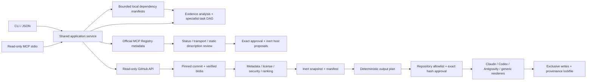

# StratAgent architecture

The CLI and read-only MCP surface share a service layer. Version 0.3 adds a provider-independent structured decision contract and a unified workspace blueprint to the commit-pinned skill, project inspection and official Registry metadata workflows. Version 0.3.1 adds CLI-only one-prompt preparation and broad, bounded source research.

Version 0.3.2 adds the [runtime research foundation](runtime-research.md). `research.py` validates model/human public query proposals and binds a separate exact egress approval. `sessions.py` records per-run source cohorts and expiry. Live preparation does not mix older cache entries into current decisions; offline/manual cache operations remain explicitly labeled. Mutable GitHub search/repository/branch observations are not cached between requests; immutable blobs/trees may be reused. Model transport/refinement, reviewed updates/recovery and source artifact audits remain separate gates in [production-readiness.md](production-readiness.md).

## Boundaries

`preparation.py` coordinates idea analysis, broad source research, Registry metadata review and blueprint/decision previews. It can initialize state and cache reviews, but cannot allow repositories, install resources, activate servers or launch agents. A matching existing workspace is preserved; changed requests/targets require a fresh workspace. Offline preparation makes no discovery requests. Its output remains `review-required` even if there are no blockers.

`discovery.py` uses whitelisted public terms to generate up to eight star-sorted GitHub queries, deduplicate public repositories and select across resource families. It reports metadata scope separately from immutable source inspection, does not load plugins, and does not treat popularity as trust. GitHub client request/time budgets and bounded snapshot attempts limit broad scans. The default 12-repository inspection budget can increase to 20 without changing source policy. See [discovery.md](discovery.md).

`project.py` reads only named dependency manifests at the root and in bounded `apps/*`/`packages/*` directories. It retains recognized dependency names, file hashes and evidence paths, not commands, private dependency names or raw manifest text. Warnings disclose incomplete or unsafe inputs. It never executes package scripts, follows symlinks or reads `.env`/source files.

`planner.py` has no IO. It maps bilingual domain and requirement evidence into specialist roles, acceptance criteria, explicit handoffs, open questions and topological parallel waves. Security review depends on the build, not just design. It clearly identifies the deterministic method and its negation/ambiguity limitations.

`github.py` uses fixed-host HTTPS GET requests with timeouts, budgets, no redirects and sanitized errors. Discovery resolves a branch once to a commit and tree. Every downloaded file must match its pinned Git blob identity. Git archives, clone hooks, repository scripts and remote package managers are never used.

`registry.py` performs one bounded fixed-host HTTPS GET to the official MCP Registry v0.1 API. Reviews bind the full response metadata, Registry-managed lifecycle status, name/version, normalized transport options and static findings. No arbitrary endpoint or package registry is contacted. Only exact-version npm stdio without runtime customizations and public HTTPS Streamable HTTP without credentials/templates produce inert proposals. npm proposals also need an allowed GitHub source repository. Metadata review does not audit package artifacts, server source, tool permissions or licenses. Remote behavior is mutable; publication is not an endorsement.

`security.py` validates paths, text encoding, sizes, modes, metadata, license notices and static risk signals. `skill_format.py` uses a pinned, bounded PyYAML safe loader with duplicate/tag/alias/type rejection; `references.py` records pinned local-document targets and non-fetched external links. Decoded metadata is scanned as well as raw files. Scanner 2 hashes typed metadata, reference evidence and explicit static-only assurance into the canonical review, rejects unsupported source authority and requires rediscovery of old scanner evidence. All candidates still require human review; executable resources remain blocked. See [resource assurance](resource-assurance.md).

`service.py` owns initialization, discovery, review, role recommendations, local allowlist, install/configuration previews, approval, provenance and verification. It recomputes current manifest evidence before planning instead of trusting editable saved task definitions. Project changes invalidate a stale configuration approval. Caches are inert JSON/base64 (skills) or JSON (Registry metadata). No candidate is installed by discovery. Only matching, explicitly installed skills are bound into generated tasks. MCP proposals use the same approval/write/lock machinery but stay under `.stratagent/proposals`, outside host auto-discovery.

`adapters.py` is a pure renderer. Skill references remain relative. Provider-specific frontmatter is stripped; Claude and Antigravity native roles are constrained to read-only exploration, and Codex roles become Agent Skills. Codex and Antigravity share `.agents/skills` and deduplicate identical outputs in combined plans. Antigravity native roles use `.agents/agents`; MCP proposals are disabled and use its `serverUrl` schema. No host config is overwritten. Adapter output hashes and explicit platform targets are part of approval, including when target sets share identical skill paths/content.

`filesystem.py` owns native POSIX/Windows locks, mode semantics, atomic replacement, directory-sync capability and redirect detection. `workspace.py` consumes that boundary to enforce safe paths, reject symlinks/junctions/reparse points and serialize local writes. `lifecycle.py` builds exact diff/stage/revalidation, ownership, backups, journal, lockfile commit point and reviewed rollback/finalization without OS-name branches. Pending work blocks other writes. Windows inherits ACLs rather than pretending chmod enforces POSIX privacy and reports directory sync unavailable. Trusted local OS/user, quiescent readers and local filesystems remain assumptions; hostile directory replacement, multi-file atomic visibility and physical power-loss certification are not claimed. See [lifecycle.md](lifecycle.md) and [OS portability](os-portability.md).

`mcp.py` is a narrow stdio adapter around the same read-only services by default. The explicit `serve --orchestration ID` mode replaces that tool list with only a session-request reader and a proposal writer scoped to one CLI-created session; the writer is not annotated read-only. This mode has no network/discovery tools. Neither mode has an install, approve, allow or arbitrary-path tool. A coding agent cannot use this server to grant itself workspace installation permission.

`orchestration.py` implements the first existing-host P2 driver: persisted request identities and proposal validation drive research-needed → awaiting-search-approval → searching → comparison-needed → optional refinement → review-required. Exact egress approval remains CLI-only. Each network round reserves bounded shared connector capacity before IO; revision-checked atomic transitions prevent stale workers/submissions from replacing cancellation or newer progress. Failure/interruption records a recoverable checkpoint without automatic replay or budget refunds. Resumption requests a new model plan. No direct model transport, currency billing cap or host subprocess is hidden in this layer. See [orchestration.md](orchestration.md) for the full state/authority/lifetime contract.

Version 0.4.1 adds model-proposed clarification questions and CLI-only revised planning input. The `answer-pending` digest checkpoint recovers an identical authorized answer across the two planning metadata writes, preserves every budget and refuses any installed environment. New context invalidates old decisions/search approvals and labels previous source summaries non-current. Domain/schema rejection reasons are returned to the host without entering sanitized event history. Bilingual offline scope is based on each occurrence's span, and explicit English/Turkish payment exclusions remain exclusions. On local POSIX filesystems, the persistent `.mutation-lock` uses kernel advisory locking; process death releases the lock without deleting/guessing an owner's directory. Legacy markers and concurrent mixed-version writers are not auto-migrated. These are P2 planning guarantees, not P3 environment transactions.

`cli.py` emits JSON results on stdout, optional structured command events on stderr, and safe error objects/exit codes. `--content` adds exact rendered text to dry-runs for review. Command events omit prompt, source text, credentials and paths. stdio serving preserves protocol-only stdout.

## Resource assurance

`artifacts.py` adds pure bounded SRI/gzip/tar, code/license/entrypoint/permission and tools/list inspection. It never extracts onto disk or runs packages; unsupported dependency closure and formats fail closed. `assurance.py` owns CLI-only fixed-host npm/OSV refresh approval, private content-addressed evidence, TTL/pending/failed state, exact local revocations and installed impact. Dynamic policy/assurance overlays do not rewrite source review identities: new evidence references and policy are separately lifecycle-approval-bound. Changing source metadata, corrupting a cache, expiring a recorded review or revoking a selected resource blocks current selection/apply. File integrity remains separate from security impact; nothing silently deletes user/host state. No new model-facing write/approval tool is introduced. The [artifact assurance contract](artifact-assurance.md) states the non-executing boundary and unsupported guarantees.

## Host adapter contract

`hosts.py` is the trusted integration boundary. Each frozen `HostAdapter` specifies a stable ID, skill root, optional native-agent root/header, and optional pure MCP proposal renderer. Its capability description distinguishes native role definitions from portable role skills and reports whether host-specific MCP proposals exist. The built-in catalog is immutable during normal execution. `stratagent platforms` exposes it without requiring a workspace.

`adapters.py` renders common skill/task content using this contract. `registry.py` reviews common MCP source metadata and delegates only host serialization. `service.py` obtains approved resource references through adapter ownership rather than recognizing vendor paths. The planner, shared primitives, application service and Registry client contain no host-name or host-directory conditionals. The canonical project analysis is identical for different target selections; role instructions, permissions and MCP field names belong to the adapter boundary.

To add a host, define a trusted adapter in the package catalog, document its actual capabilities, and add format/security/approval tests plus a disposable-client loading check. No changes to the project planner, source security policy or approval writer should be required. A regression test adds an original example adapter through the same contract and verifies skill, role and MCP rendering without modifying those core modules. This is a code extension point, not an external plugin loader or an execution sandbox.

Output merging permits identical shared files but rejects conflicting bytes at the same destination. Resource assignment includes only paths recognized by selected adapters. Target selection remains approval-bound even when shared files are identical. `generic` supplies portable Agent Skills/roles and the task plan; MCP metadata stays inspectable, but no universal host MCP settings format or portable permission enforcement is claimed. CLI defaults are maintained at the adapter/UI boundary and do not affect project reasoning.

## Architectural decision pipeline

`intent.py` extracts bounded, cited scope evidence and compares coordination tradeoffs. `planner.py` builds the rule-generated fallback with explicit specialist role options, selected/omitted responsibilities and a dependency graph. Neither requires a model provider or a host SDK.

`blueprint.py` is pure: it builds a canonical evidence context, publishes a strict decision schema, validates an optional external proposal, resolves allowed domain/requirement interpretations, and binds eligible reviewed resource IDs to roles. Model text is data, not permission authority. Unknown fields/sources/evidence, stale context, explicit-scope contradictions, missing role bindings, blocked resources and incompatible offline selections fail closed. Quotes and references provide provenance, not a proof of model reasoning quality.

`service.py` joins the interpreted decision with reviewed snapshots, hashes any reused standalone output, merges new skill/role/inert-MCP files and saves one blueprint/task-plan under one exact approval. The existing allowlist, collision refusal, write lock, rollback and verification code retain installation authority. The read-only MCP surface exposes decision context and previews only. No LLM API, package manager or third-party executable is called by this pipeline.

See [decision-workflow.md](decision-workflow.md) for the current input contract, role/resource reasoning, examples and integration limits.

## State contract

Manifest/policy, stage and transaction documents use `schema_version: 1`. Lockfiles support valid legacy v1 and reviewed v2 migration; unknown versions fail closed. V2 adds a monotonic revision, exact per-path owner index and output modes. Reads do not migrate state; the next approved mutation records migration and can restore the exact original lock on failure. Cached external Registry JSON retains its upstream shape. The manifest contains the operator-approved request/analysis, targets and skill/MCP reviews. Policy contains exact normalized `owner/repo` allowances. Lock records retain source identities, approvals, output hashes/modes, generator version and provenance. Approval is not a signature. `status` distinguishes the current request from the installed blueprint; reviewed request revision deliberately leaves old installed output intact until a separately approved new blueprint.

Preparation adds `.stratagent/runs/ID.json` with a bounded, schema-checked research cohort, context digest, mode, UTC epoch start/expiry, partial flag and egress-approval reference. Run IDs, source reviews, current project/targets, integrity digest and a 15-minute freshness policy are validated before scoped decision/preview/apply. Expiry changes status, not installed file contents or the ability to verify them. Legacy operations without a run are labeled unscoped-cache and cannot reuse a runtime approval. Self-consistency digests are not protection against a malicious local user who can rewrite all state.

`review_digest` hashes reviewed source/metadata and findings, excluding project-dependent ranking. Version 0.5 mutation approvals also bind the absolute workspace, rendered output, generator, targets, complete current lock, policy/manifest/current analysis and observed managed-file state. A repository allowance never approves arbitrary future content. Stage application re-renders/re-inspects evidence and run freshness, not just stored hashes. Exact repeated effects verify/no-op; changes require fresh explicit approval. Removal refuses dependencies and drift, and no path is adopted from another owner or a user file. Journal backups/stages are private state, not telemetry or an external registry.

## Extension points

The service API is shared by CLI and MCP. An existing model or human can supply a grounded structured decision through `decision-request`/`blueprint` without binding the core to a model vendor. A direct API-backed provider or external installer can be added later with explicit data/authority boundaries; neither is currently implemented. Additional hosts add pure renderers without network or execution authority. Actual agent execution remains an independently authorized concern rather than an implicit side effect of importing a skill.
